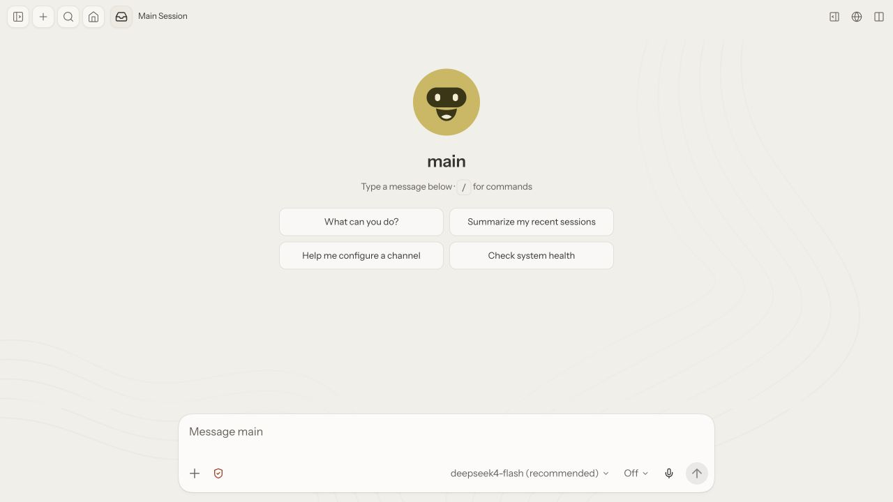
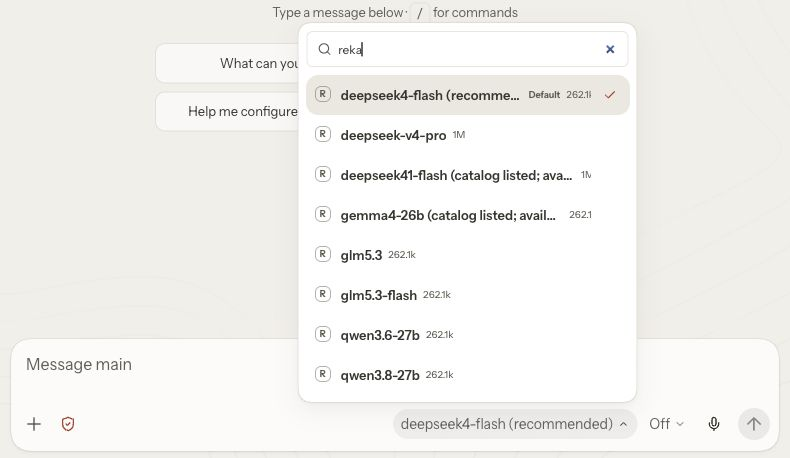

# Set up Reka in OpenClaw

Connect Reka, start with DeepSeek 4 Flash, and switch models from chat.

You need **OpenClaw 2026.10.2 or newer** and Node **24.16+ within 24.x, or 26.1+**. Have your API key ready from [Reka's developer portal](https://developer.reka.ai).

```sh
openclaw --version
node --version
```

If OpenClaw is not installed yet, follow the [official installation guide](https://docs.openclaw.ai/install). Its onboarding is fine to complete first; the steps below add Reka to an existing setup.

## 1. Install the plugin

Reka publishes the plugin on ClawHub as `openclaw-reka-provider`:

```sh
openclaw plugins install clawhub:openclaw-reka-provider
```

OpenClaw asks you to accept the plugin's capabilities; review and accept. It prints `Installed plugin: reka` when it finishes. If a Gateway is already running, restart it through its existing service owner so it loads the plugin. For an OpenClaw-managed service, use `openclaw gateway restart`. [Plugin installation](https://docs.openclaw.ai/cli/plugins/install)

<details>
<summary>Install from source instead (before the first ClawHub release, or to test a branch)</summary>

From a checkout of this repository:

```sh
npm pack ./plugin
openclaw plugins install npm-pack:./openclaw-reka-provider-0.1.0.tgz
```

`npm pack` prints the file name; 0.1.0 is the current version. OpenClaw warns that the source is outside ClawHub and asks about capabilities; review both. Updates from source mean pulling, packing and installing again with `--force`, since `openclaw plugins update` follows ClawHub or npm only.

</details>

## 2. Check that Reka is enabled

```sh
openclaw plugins list | grep -i reka
```

If it shows `disabled`, run `openclaw plugins enable reka`. A reinstall keeps a plugin disabled when it was disabled before.

## 3. Connect your Reka account

```sh
openclaw models auth login --provider reka --method api-key
```

Wait for **Enter your Reka API key**, then paste the key and press Enter. The input is masked, but text pasted before the prompt appears is echoed in plain text, so wait for it. Never put the key in the command itself.

If OpenClaw offers to restrict the model picker, keep all Reka models: the list comes from your account and grows when Reka adds models. A Gateway-refresh warning can appear before the Gateway has started; continue if the key was saved. [Model authentication](https://docs.openclaw.ai/cli/models#auth-profiles)

## 4. Choose DeepSeek 4 Flash

```sh
openclaw models set reka/deepseek4-flash
openclaw config set agents.defaults.thinkingDefault off
```

Flash becomes the default for new chats. Thinking off keeps replies fast; without it, OpenClaw applies its own thinking default to reasoning models. Existing chats may keep their own setting. Confirm with:

```sh
openclaw models status
```

## 5. Open a chat

If no Gateway is running, start one and leave the terminal open:

```sh
openclaw gateway
```

In a second terminal:

```sh
openclaw dashboard
```

Check that **deepseek4-flash** appears below the message box, then try:

> Turn these notes into an action list: Maya finishes onboarding Friday. Leo fixes signup Monday. Nina contacts five pilot users. Flag missing deadlines.



Your first reply confirms that the key can make requests.

## Switch models

Click the model name below the message box and search for **Reka**.



Or send a model command as its own chat message, for example:

```text
/model reka/deepseek-v4-pro
```

`/model` changes the current chat. `openclaw models set <model>` changes the default for new chats. Pick a model that accepts images when you need image input.

### Where the model list comes from

When the Gateway starts, when your key changes, and when you run `openclaw models list --refresh` (or press **Refresh** under Models), the plugin reads `GET https://api.reka.ai/v1/models` with your key. Listing models is not an inference request and is not billed, though Reka refuses it for an account with no credit. From that list, only ready models that support tool calling are offered.

The plugin keeps each result for about 10 minutes (1 minute after a failed read), so a refresh inside that window shows the same list. Restart the Gateway to read it again straight away.

A bundled list of models ships with each plugin release. OpenClaw shows those models straight after sign-in, and the plugin uses them if Reka cannot be reached. They stay in the picker until the next plugin release, even if Reka pauses or retires one of them.

## If something needs attention

| What you see | What to do |
| --- | --- |
| `openclaw` not found or a Node compatibility error | Use the terminal where OpenClaw works and check the versions above. |
| Reka is missing | Run `openclaw plugins list`. If it is disabled, run `openclaw plugins enable reka`. Check `openclaw plugins doctor` for load errors. |
| A new Reka model is missing | Run `openclaw models list --provider reka --refresh`. If it is still missing, wait up to 10 minutes or restart the Gateway. If you restricted the picker during sign-in, sign in again and keep all Reka models. |
| Authentication or insufficient-credit error | Re-enter the key through the masked login prompt. For a balance or credit error, check your Reka account; a new key alone may not fix it. |
| Model not found | Reka may have paused or retired that model; choose another one. Models from the bundled list can still appear in the picker until the next plugin release. |
| Chat keeps the old model | Start a new chat, or use `/model reka/deepseek4-flash` in the current one. |

## Update

```sh
openclaw plugins update reka
```

OpenClaw re-resolves the ClawHub release you installed and runs ClawHub's release checks before replacing it. A new release can also refresh the bundled model list.

## Undo or remove

Select another provider's model before disabling Reka. To disable the plugin but keep it installed:

```sh
openclaw plugins disable reka
```

To remove it, preview the changes, then confirm:

```sh
openclaw plugins uninstall reka --dry-run
openclaw plugins uninstall reka
```

Saved credentials are separate. Find the profile with `openclaw models auth list --provider reka`, then remove it with `openclaw models auth logout <profile-id>`; both need the local Gateway stopped. To restore OpenClaw's default thinking setting, run `openclaw config unset agents.defaults.thinkingDefault`. [Plugin removal](https://docs.openclaw.ai/cli/plugins/uninstall-and-update) · [Credential removal](https://docs.openclaw.ai/cli/models#auth-profiles)
